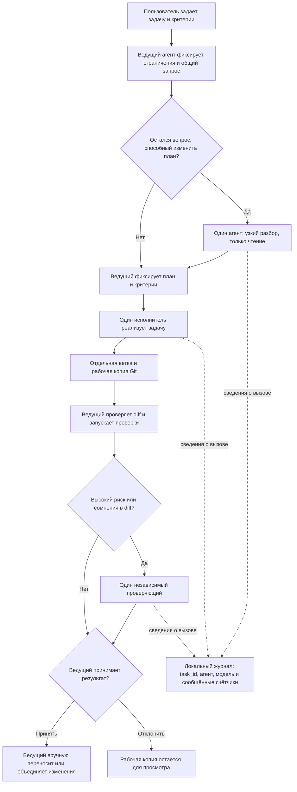

# Пример: сложная задача с контролем числа вызовов

Этот пример показывает экономный порядок для изменения, где важны совместимость, миграция данных и безопасность: ведущий, один исполнитель, затем независимая проверка при высокой цене ошибки. Параллельный разбор нескольких агентов нужен только если остаётся вопрос, на который разные мнения могут повлиять на решение.

## Задача

В существующем сервисе API-ключи хранятся в открытом виде. Нужно перейти на хранение хешей, сохранив действующие интеграции и добавив безопасную выдачу, ротацию и отзыв ключей.

Критерии готовности:

- существующие клиенты не теряют доступ во время миграции;
- новый секрет показывается только при создании, а в журналах не появляется;
- ключ можно ротировать и отозвать;
- миграцию можно безопасно продолжить после частичного сбоя;
- проверки покрывают совместимость, миграцию и отзыв.

## Схема процесса



По умолчанию достаточно двух агентов всего: ведущего и исполнителя. Ведущий сам проверяет diff и результаты проверок. Если из-за цены ошибки нужна независимая проверка, добавляется один проверяющий. Исследователь подключается, только если остаётся конкретный вопрос, способный изменить план; две или три параллельные консультации оставляют для особо спорных решений. Повторять вызов следует только после сбоя или конкретного замечания. На один чат мост жёстко ограничивает число запусков четырьмя, а число разных помощников — тремя. Параллельная консультация расходует по запуску на каждого участника.

## Пример вызовов

В примере ниже Antigravity — ведущий. Он передаёт реализацию одному исполнителю, используя `task_id` для просмотра общих расходов по задаче:

```json
{
  "agent": "codex",
  "mode": "implement",
  "task_id": "api-key-hash-migration",
  "cwd": "/path/to/service",
  "task": "Реализуй согласованный план: ... Сохрани совместимость согласно критериям выше. Добавь необходимые проверки. Не отправляй изменения и не объединяй ветки."
}
```

После реализации ведущий сам проверяет diff и запускает проверки. Если изменение остаётся высокорисковым, он может вызвать `delegate_agent` в режиме `research` для независимой проверки diff, указав рабочую копию агента в `cwd`. Повторная реализация нужна только если проверка выявила конкретную проблему. Для действительно спорного архитектурного решения вместо одного исследователя можно вызвать `consult_agents` с двумя независимыми мнениями, но не запускать оба пути подряд без причины. Используй тот же `task_id` для `usage_report`.

Если ведущий сам Codex, выбери другого агента в поле `agent`: мост не предлагает ведущего в качестве собственного исполнителя. Для выбранной модели используются настройки роли `research` или `implement`.

## В чём ценность и границы

Обычный одиночный проход может слишком рано закрепиться на первом объяснении или плане. Этот порядок сохраняет возможность независимой проверки, но добавляет её только когда ожидаемая польза оправдывает отдельный вызов. Рабочая копия позволяет изучить изменения до переноса в основную ветку.

Это способ **снизить риск привязки к одному исходному взгляду**, а не гарантия устранения предвзятости или ошибок. Модели могут разделять общие заблуждения; ведущий может выбрать слабый план; проверяющие могут пропустить дефект. Поэтому ответы нужно сверять с требованиями и репозиторием, а diff и проверки — изучать до объединения. Исследования многоагентных систем показывают как потенциальные преимущества координации на отдельных задачах, так и системные сбои в постановке, взаимодействии и проверке результата: [обзор сбоев на записях работы систем](https://arxiv.org/abs/2503.13657), [сравнение многоагентной координации с отдельными моделями](https://arxiv.org/abs/2509.23537).

Механизм особенно полезен для сложных изменений, когда цена неверного допущения высока и можно проверить независимые варианты по коду, ограничениям и тестам. Для небольших одношаговых задач несколько вызовов добавят задержку и расход токенов без очевидной пользы.
