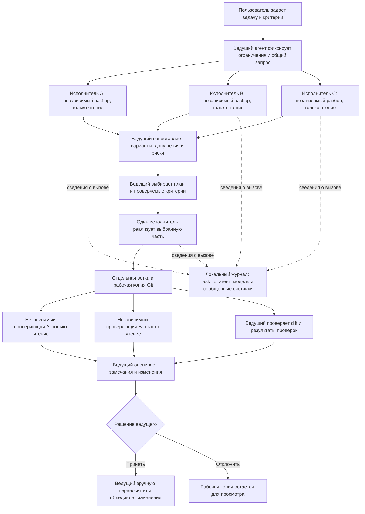

# Пример: сложная задача без единственной точки зрения

Этот пример показывает, как использовать мост при изменении, где важны совместимость, миграция данных и безопасность. Цель — не заставить несколько моделей голосовать за один ответ, а дать ведущему независимые варианты и основания для решения до начала реализации.

## Задача

В существующем сервисе API-ключи хранятся в открытом виде. Нужно перейти на хранение хешей, сохранив действующие интеграции и добавив безопасную выдачу, ротацию и отзыв ключей.

Критерии готовности:

- существующие клиенты не теряют доступ во время миграции;
- новый секрет показывается только при создании, а в журналах не появляется;
- ключ можно ротировать и отозвать;
- миграцию можно безопасно продолжить после частичного сбоя;
- проверки покрывают совместимость, миграцию и отзыв.

## Схема процесса



Исполнители для разбора получают один исходный запрос независимо друг от друга и не видят ответы коллег до ответа ведущему. Мост запускает консультации параллельно в режимах разбора без записи. Для реализации ведущий выбирает одного доступного исполнителя; тот работает в отдельной ветке и рабочей копии. Результат возвращается как diff для проверки. Автоматического объединения или отправки изменений нет.

## Пример вызовов

В примере ниже Antigravity — ведущий, поэтому Codex, Claude и OpenCode доступны ему как исполнители. Замени список на установленные программы, кроме текущего ведущего.

Сначала попроси независимые варианты:

```json
{
  "agents": ["codex", "claude", "opencode"],
  "task_id": "api-key-hash-migration",
  "cwd": "/path/to/service",
  "task": "Независимо предложите план миграции API-ключей с открытого хранения на хеши. Учитывайте действующие интеграции, выдачу и однократный показ новых секретов, ротацию, отзыв, частичный сбой миграции, утечки через журналы и проверяемые критерии. Для каждого решения перечислите допущения, риски и способ проверки. Не редактируйте файлы. Сначала опишите собственный вариант и не исходите из предположений о чужих предложениях."
}
```

Ведущий сравнивает ответы, проверяет спорные допущения по коду и документации проекта и формирует окончательный план. Затем передаёт реализацию одному доступному исполнителю, используя тот же `task_id`:

```json
{
  "agent": "codex",
  "mode": "implement",
  "task_id": "api-key-hash-migration",
  "cwd": "/path/to/service",
  "task": "Реализуй согласованный план: ... Сохрани совместимость согласно критериям выше. Добавь необходимые проверки. Не отправляй изменения и не объединяй ветки."
}
```

После реализации ведущий может снова вызвать `consult_agents`, указав в `cwd` путь к возвращённой рабочей копии и попросив проверить diff по критериям безопасности, совместимости и миграции. Используй тот же `task_id`, чтобы собрать вызовы в одном отчёте `usage_report`.

Если ведущий сам Codex, убери его из списка консультантов и замени `"agent": "codex"` на доступного исполнителя: мост не предлагает ведущего в качестве собственного исполнителя. Для выбранной модели используются настройки роли `research` или `implement`.

## В чём ценность и границы

Обычный одиночный проход может слишком рано закрепиться на первом объяснении или плане. Здесь ведущий сначала получает несколько самостоятельных разборов, затем выбирает решение, а реализация и проверка происходят на отдельных этапах. Отдельная рабочая копия позволяет изучить изменения до переноса в основную ветку.

Это способ **снизить риск привязки к одному исходному взгляду**, а не гарантия устранения предвзятости или ошибок. Модели могут разделять общие заблуждения; ведущий может выбрать слабый план; проверяющие могут пропустить дефект. Поэтому ответы нужно сверять с требованиями и репозиторием, а diff и проверки — изучать до объединения. Исследования многоагентных систем показывают как потенциальные преимущества координации на отдельных задачах, так и системные сбои в постановке, взаимодействии и проверке результата: [обзор сбоев на записях работы систем](https://arxiv.org/abs/2503.13657), [сравнение многоагентной координации с отдельными моделями](https://arxiv.org/abs/2509.23537).

Механизм особенно полезен для сложных изменений, когда цена неверного допущения высока и можно проверить независимые варианты по коду, ограничениям и тестам. Для небольших одношаговых задач несколько вызовов добавят задержку и расход токенов без очевидной пользы.
